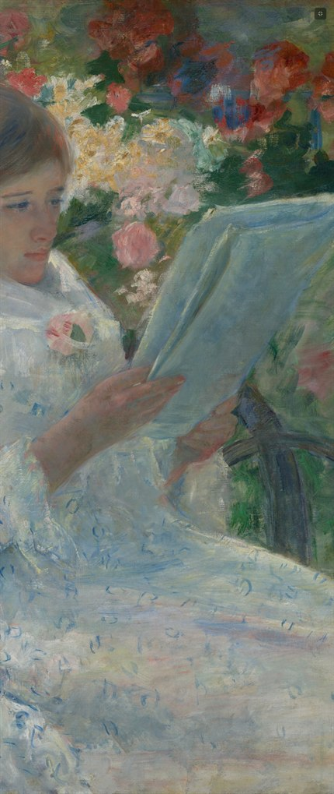
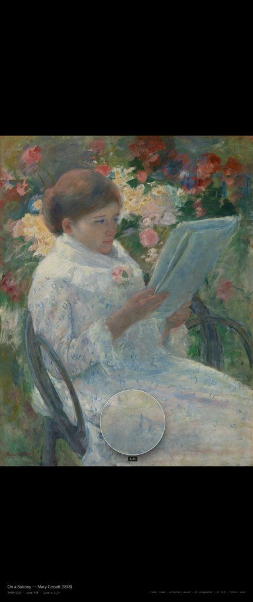
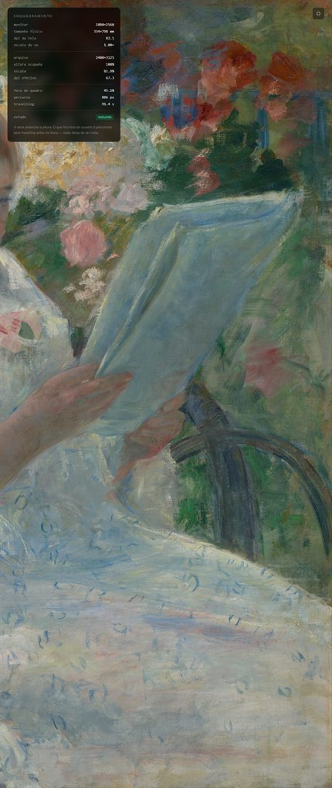
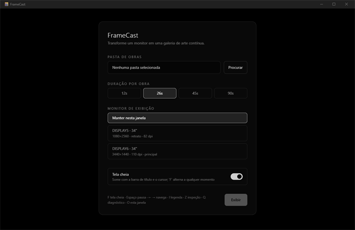

<div align="center">

# FrameCast

**Transforme um monitor ocioso numa galeria de arte.**

Aplicativo desktop nativo que exibe pinturas em domínio público de museus
como quadros de parede — em tela cheia, sem perder nada da obra e sem
inventar pixel nenhum.

[](https://github.com/hqr90/galeria/releases/latest)
&nbsp;




</div>

---

## O problema

Um monitor secundário parado é uma moldura vazia. Só que exibir pintura numa
tela não é exibir foto: o painel tem uma proporção, a obra tem outra, e as duas
saídas óbvias são ruins. Encaixar a obra inteira deixa metade da tela preta.
Preencher a tela corta a pintura — e o pedaço cortado nunca é visto.

O FrameCast preenche a altura inteira e **percorre o que ficou de fora**, com um
travelling lateral que vai de uma borda à outra da pintura antes de trocar de
obra. Cortar aqui adia, não elimina.

## Instalação

Baixe o instalador em **[Releases](https://github.com/hqr90/galeria/releases/latest)**
(`FrameCast_x.y.z_x64-setup.exe`) e execute. Windows 10/11 x64, com o WebView2
Runtime que o Windows 11 já traz.

O instalador não é assinado, então o SmartScreen avisa na primeira execução:
**Mais informações → Executar assim mesmo**.

## O que ele faz

- **Preenche a altura** do painel e percorre o transbordo por travelling, sem
  deixar nenhuma parte da obra de fora do ciclo.
- **Nunca amplia** o arquivo além do que ele contém — a nitidez é do original,
  não de interpolação.
- **Velocidade constante** de travelling: o tempo de cada obra vem do percurso,
  não é fixo. Uma obra mais larga fica mais tempo no ar.
- **Modo de inspeção** com zoom, arrasto e uma lupa que antecipa o 1:1.
- **Coletor de acervo** que baixa pinturas em domínio público de três museus de
  acesso aberto, no tamanho certo para o seu monitor.
- **Leve**: ~25 MB de RAM em execução, executável de 3,6 MB.

<div align="center">
<table>
<tr>
<td align="center">
<br />
<sub><b>Inspeção com lupa</b><br />mostra o 1:1 enquanto a base está abaixo dele</sub>
</td>
<td align="center">
<br />
<sub><b>Diagnóstico (tecla <code>Q</code>)</b><br />DPI real da tela, escala, fração cortada</sub>
</td>
</tr>
</table>



</div>

## Enquadramento

A obra ocupa **toda a altura** do painel. Numa tela 1:2,37 — um ultrawide de 34"
girado para retrato — isso corta as laterais, porque nenhuma pintura tem essa
proporção. O que fica fora do quadro é percorrido pelo travelling antes do
crossfade.

Como o percurso varia de obra para obra, a duração é derivada: a velocidade é
constante (o quadro visível se renova a cada 15 s, medido em função da largura
da tela) e a duração escolhida na configuração funciona como piso. Uma obra que
transborda 2760 px fica no ar ~38 s; uma que cabe na largura fica o mínimo.

Toda a conta é feita em **pixels de dispositivo**, não em pixels CSS: numa tela
a 150% de escala, 1 px CSS vale 1,5 px físico, e ignorar isso ampliaria a imagem
em 50% sem que a matemática percebesse. O DPI real vem do GDI
(`GetDeviceCaps`), que já devolve as medidas na orientação atual — o EDID cru
reporta sempre o painel deitado, e erraria por 34% num monitor girado.

## Inspeção

`Z` (ou duplo clique) congela o ciclo e abre a obra para exame, começando pela
**obra inteira** na tela: a roda do mouse dá zoom ancorado no cursor, arrastar
move, `0` volta à visão geral e `1` salta para o 1:1. O zoom vai até 4×; a
partir do 1:1 o rodapé marca em âmbar quanto está sendo interpolado, para a
interface não fingir detalhe que não existe.

Enquanto o zoom base está abaixo do 1:1, uma **lupa** segue o cursor mostrando
aquele trecho já em tamanho real, com o fator de aumento ao pé. Ela some sozinha
ao chegar no 1:1: dali para cima a base já mostra mais do que o arquivo tem.

## Acervo

O app exibe qualquer pasta de imagens (`jpg`, `jpeg`, `png`, `webp`, `avif`, até
3 níveis de subpastas). Para montar um acervo do zero:

```bash
npm run art                      # 2560 px de altura, o padrão
npm run art -- artwork 3840      # outra altura de painel
```

Baixa pinturas em domínio público das APIs de acesso aberto do **Art Institute
of Chicago**, do **Metropolitan Museum of Art** e do **Cleveland Museum of
Art**, gerando `artwork/manifest.json` e `artwork/CREDITS.md` com a atribuição
de cada obra.

O coletor busca **pela altura do painel** e descarta o que vier mais baixo,
porque esticar seria a única perda que o render não consegue evitar. No Art
Institute isso é um parâmetro do IIIF; no Cleveland e no Met, onde o derivado
tem tamanho fixo, a altura é conferida no arquivo baixado. Ele aceita só
`Painting`/`Drawing`/`Watercolor`, prefere formato retrato — que corta menos — e
é idempotente: reexecutar não rebaixa o que já está em disco e remove da pasta o
que não passa mais nos filtros.

Categorias, cotas e termos de busca ficam em
[`scripts/fetch-art.mjs`](scripts/fetch-art.mjs). Os critérios de seleção têm 66
casos de teste em [`scripts/test-filters.mjs`](scripts/test-filters.mjs) — busca
por texto livre traz muito lixo temático, e as regex que separam o joio merecem
teste.

## Atalhos

| Tecla | Ação |
| --- | --- |
| `F` / `F11` | Alterna tela cheia |
| `Esc` | Sai da tela cheia |
| `Espaço` | Play / Pause |
| `←` `→` | Obra anterior / próxima |
| `I` | Liga/desliga a legenda |
| `Z` | Modo de inspeção (também por duplo clique) |
| `Q` | Diagnóstico de enquadramento e DPI |
| `O` | Reabre a configuração |

Cursor e interface somem após 2 s de inatividade do ponteiro.

## Compilar do código

Requer [Node 20+](https://nodejs.org) e [Rust estável](https://rustup.rs).

```bash
npm install
npm run app          # desenvolvimento com hot reload
npm run app:build    # instalador em src-tauri/target/release/bundle/nsis
```

## Estrutura

```
src-tauri/src/commands/fs_scanner.rs       varredura de diretório (walkdir)
src-tauri/src/commands/window_manager.rs   monitores, DPI físico, tela cheia
src/hooks/useFrameFit.ts                   enquadramento em pixels de dispositivo
src/hooks/useGalleryMotion.ts              travelling de velocidade constante
src/components/CanvasLayer.tsx             camada do double-buffer
src/components/InspectorLayer.tsx          zoom, arrasto e lupa
scripts/fetch-art.mjs                      coletor de acervo
```

## Licença

[MIT](LICENSE) — Hilton Queiroz Rebello.

As obras baixadas pelo coletor são de domínio público ou CC0, cedidas pelos
programas de acesso aberto dos museus; o `CREDITS.md` gerado registra a
atribuição de cada uma.
